<div align="center">

# Kunal Chavan

**M.S. Computer Science @ UMass Amherst · Research Assistant @ MBZUAI · B.Tech ECE, VIT Vellore**

*Building vision-language models for geospatial understanding*

**Open to Summer 2027 internships in ML, computer vision and AI engineering**

[](https://kunalchavan245.github.io)
[](https://www.linkedin.com/in/kunal-chavan-india)
[](mailto:kunalchavan245@gmail.com)
[](https://github.com/KunalChavan245)

</div>

---

## About

I am a researcher working at the intersection of **computer vision**, **vision-language models**, and **geospatial AI**. Currently a Research Assistant at the **Mohamed Bin Zayed University of Artificial Intelligence (MBZUAI)**, where I am building *TerraSAM* — an agentic segmentation pipeline for zero-shot instance segmentation of satellite imagery using SAM3 and VLMs.

I am pursuing an M.S. in Computer Science at the **University of Massachusetts Amherst**, after a B.Tech in Electronics and Communication Engineering from **VIT Vellore** (GPA: 8.29). My work spans the full stack from model design to edge deployment on Raspberry Pi and NVIDIA Jetson hardware.

```
Current focus  →  VLMs for geospatial segmentation · Agentic AI · Remote sensing
Past work      →  IoT security · Video restoration · Edge CV · Assistive tech
```

---

## Education

| Period | Degree | Institution |
|---|---|---|
| 2026 – 2028 (expected) | M.S. in Computer Science | University of Massachusetts Amherst |
| 2021 – 2025 | B.Tech in Electronics and Communication Engineering (GPA: 8.29) | Vellore Institute of Technology, Vellore |

---

## Research Experience

| Period | Role | Institution |
|---|---|---|
| Dec 2025 – Present | **Research Assistant** | Mohamed Bin Zayed University of AI (MBZUAI) |
| May 2025 – Sep 2025 | Research Intern | Indian Institute of Technology, Guwahati |
| Jan 2024 – Aug 2024 | Research Intern | National University of Singapore |
| Jun 2024 – Jul 2024 | Research Intern | Indian Institute of Technology, Dharwad |
| Mar 2024 – Jun 2024 | Computer Vision Intern | Vellore Institute of Technology |
| Sep 2023 – Nov 2023 | Data Science Intern | Quick Heal Technologies |

---

## Selected Publications

📄 **AIoT Enhanced Night Vision Object Detection for Vehicle Safety** — [IEEE NETAPPS 2024](https://ieeexplore.ieee.org/abstract/document/10823504)

📄 **Optimizing IoT Security: A ML Pipeline for Fast Intrusion Detection** — [IEEE NETAPPS 2024](https://ieeexplore.ieee.org/abstract/document/10823425)

📄 **VocalEyes: Vision-Language Models for the Visually Impaired** — [IEEE ICEI 2024 @ IIT Dharwad](https://ieeexplore.ieee.org/abstract/document/10912415)

📄 **NoiseFed: Federated Learning for Breast Cancer Detection** — Preprint 2024

---

## Featured Projects

| Project | Description | Status |
|---|---|---|
| [**TerraSAM**](https://github.com/KunalChavan245/TerraSam) | Agentic VLM pipeline for geospatial segmentation (SAM3 + LLM) | 🟢 Ongoing |
| [**Video Restoration**](https://github.com/KunalChavan245/Work-at-IIT-G-on-Video-Restoration-of-Weather-Degraded-Videos) | Weather-degraded video restoration — Swin + Restormer (+5% PSNR) | 🔵 Research |
| [**DarkRoad IoT Guardian**](https://github.com/KunalChavan245/DarkRoad-IoT-Guardian) | Night-vision object detection on Raspberry Pi 5 — IEEE Published | ✅ Complete |
| [**NetSentry IoT**](https://github.com/KunalChavan245/NetSentry) | ML-driven network intrusion detection — 0.952 accuracy — IEEE Published | ✅ Complete |
| [**VocalEyes**](https://ieeexplore.ieee.org/abstract/document/10912415) | Assistive vision system for the visually impaired using Florence-2 on Jetson | ✅ Complete |

---

## Tech Stack

**Languages**


**Frameworks & Libraries**


**Hardware & Platforms**


**Certifications**


---

## GitHub Stats

<div align="center">

<!-- Generated daily by .github/workflows/grs.yml and stored in this repo, so they never depend on a public server. -->
<!-- The workflow fills the STATS markers once a STATS_TOKEN secret exists; until then only the languages card shows. -->
<!-- STATS:START --><!-- STATS:END -->


</div>

---

<div align="center">

*Open to Summer 2027 internships and research collaborations · Vision-Language Models · Geospatial AI · Edge Deployment*

**[Website](https://kunalchavan245.github.io) · [LinkedIn](https://www.linkedin.com/in/kunal-chavan-india) · [Email](mailto:kunalchavan245@gmail.com)**

</div>
